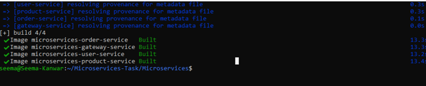
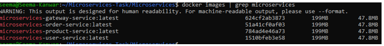
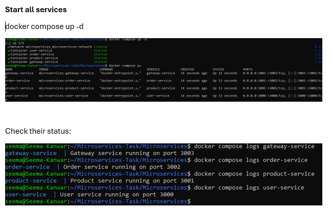
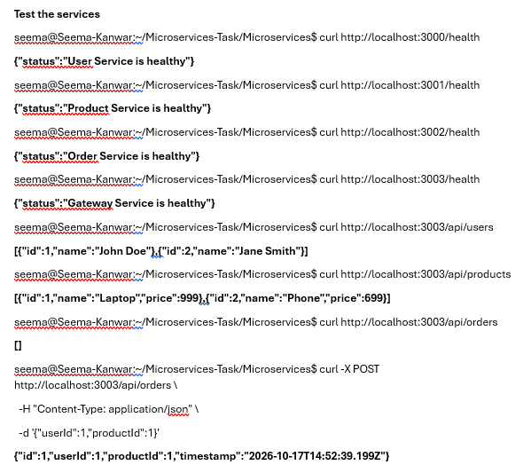
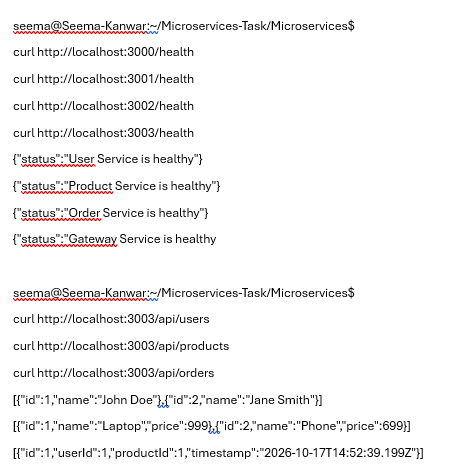
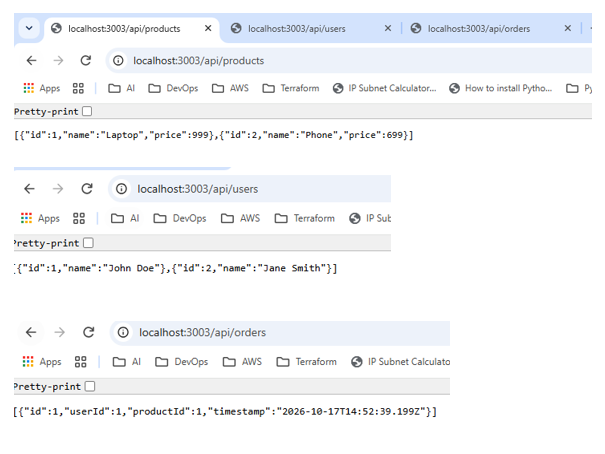

# Microservices Application Using Docker and Docker Compose

## Project Overview

This project demonstrates how to containerize a Node.js microservices application using Docker and manage multiple containers using Docker Compose.

The application contains three core microservices and one API Gateway:

| Service | Responsibility | Port |
|---|---|---:|
| User Service | Handles user-related requests | 3000 |
| Product Service | Handles product-related requests | 3001 |
| Order Service | Handles order-related requests | 3002 |
| Gateway Service | Routes requests to the core services | 3003 |

Docker provides isolated environments for each service, while Docker Compose simplifies building, starting, and managing the application.

---

# 1. Dockerfile Creation

A Dockerfile contains the instructions required to build a Docker image for an application. Each service has its own Dockerfile so that it can be built and run independently.

## 1.1 Node.js Base Image

Each service uses an appropriate Node.js base image, such as `node:18-alpine`.

```dockerfile
FROM node:18-alpine
```

**Explanation:**

- `FROM` specifies the base image.
- `node:18-alpine` provides the Node.js runtime in a relatively lightweight Alpine Linux image.
- The runtime allows the application to execute JavaScript outside the browser.

## 1.2 Working Directory

Each Dockerfile sets a working directory:

```dockerfile
WORKDIR /app
```

**Explanation:**

- Creates and selects `/app` as the working directory inside the container if necessary.
- Subsequent file and command operations use this directory by default.
- It keeps application files organized inside the image.

## 1.3 Dependency Installation

The service dependencies are installed using npm.

A typical Dockerfile section is:

```dockerfile
COPY package*.json ./
RUN npm install
```

**Explanation:**

- `COPY package*.json ./` copies the package manifest and lockfile, if present, into the working directory.
- `RUN npm install` installs the dependencies declared by the application.

For reproducible builds, use `npm ci` when a valid `package-lock.json` exists and is synchronized with `package.json`.

## 1.4 Copy Application Files

```dockerfile
COPY . .
```

This copies the remaining application files into the container's working directory. A suitable `.dockerignore` should exclude unnecessary files such as `node_modules` and `.git`.

## 1.5 Expose the Correct Port

Each service declares its application port:

| Service | Dockerfile instruction |
|---|---|
| User Service | `EXPOSE 3000` |
| Product Service | `EXPOSE 3001` |
| Order Service | `EXPOSE 3002` |
| Gateway Service | `EXPOSE 3003` |

The `EXPOSE` instruction documents the port the application listens on inside the container. Port publishing is configured separately in Docker Compose.

## 1.6 Start the Application

Each Dockerfile includes a valid `CMD` instruction. For an application whose entry point is `app.js`:

```dockerfile
CMD ["node", "app.js"]
```

This starts the Node.js application when a container is launched from the image.

## 1.7 Build the Images

From the project root, build the service images:

```bash
docker compose build
```

Check that the images were created:

```bash
docker images | grep microservices
```

### Validation

The build should complete successfully for all four services:

- User Service
- Product Service
- Order Service
- Gateway Service

**Screenshot reference:** `screenshots/docker-images.png`

---

# 2. Docker Compose Configuration

Docker Compose defines how multiple containers are built, configured, connected, and started together.

The project uses `docker-compose.yml` (or `compose.yaml`) to manage the services.

## 2.1 Define the Services

The Compose file defines the User, Product, Order, and Gateway services. Each service has its own build context and Dockerfile.

Example:

```yaml
services:
  user-service:
    build:
      context: ./user-service
      dockerfile: Dockerfile
    container_name: user-service
    ports:
      - "3000:3000"
    networks:
      - microservices-network

  product-service:
    build:
      context: ./product-service
      dockerfile: Dockerfile
    container_name: product-service
    ports:
      - "3001:3001"
    networks:
      - microservices-network

  order-service:
    build:
      context: ./order-service
      dockerfile: Dockerfile
    container_name: order-service
    ports:
      - "3002:3002"
    networks:
      - microservices-network

  gateway-service:
    build:
      context: ./gateway-service
      dockerfile: Dockerfile
    container_name: gateway-service
    ports:
      - "3003:3003"
    networks:
      - microservices-network
    depends_on:
      - user-service
      - product-service
      - order-service

networks:
  microservices-network:
    driver: bridge
```

This example reflects the configuration used during local testing.

## 2.2 Port Mapping

The port mapping format is:

```text
HOST_PORT:CONTAINER_PORT
```

For example:

```yaml
ports:
  - "3000:3000"
```

This makes port 3000 inside the User Service container accessible through port 3000 on the host machine.

The application uses these mappings:

| Service | Host port | Container port |
|---|---:|---:|
| User Service | 3000 | 3000 |
| Product Service | 3001 | 3001 |
| Order Service | 3002 | 3002 |
| Gateway Service | 3003 | 3003 |

## 2.3 Shared Network

The Compose file creates a bridge network named `microservices-network`.

```yaml
networks:
  microservices-network:
    driver: bridge
```

All four services join this network, allowing containers to communicate using service names and internal ports.

For example, the Gateway Service can call:

- `http://user-service:3000`
- `http://product-service:3001`
- `http://order-service:3002`

These internal URLs work when the services listen on the specified ports and the gateway is configured to use them.

## 2.4 Service Dependencies

The Gateway Service specifies:

```yaml
depends_on:
  - user-service
  - product-service
  - order-service
```

This establishes startup ordering. It does not, by itself, guarantee that the dependent applications are ready to handle requests.

## 2.5 Validate the Compose Configuration

Run:

```bash
docker compose config
```

If the configuration is valid, Compose prints the resolved configuration without reporting a YAML or configuration error.

**Screenshot reference:** `screenshots/docker-compose-config.png`

---

# 3. Local Testing and Validation

The application was built and started locally using Docker Compose.

## 3.1 Build and Start the Application

From the directory containing the Compose file, run:

```bash
docker compose up -d --build
```

**Explanation:**

- `up` creates and starts the containers.
- `-d` runs them in the background.
- `--build` builds the images before starting the containers.

## 3.2 Verify Running Containers

Run:

```bash
docker ps
```

The expected services are:

| Container | Expected status | Published port |
|---|---|---|
| `user-service` | Up | `3000:3000` |
| `product-service` | Up | `3001:3001` |
| `order-service` | Up | `3002:3002` |
| `gateway-service` | Up | `3003:3003` |

All four containers were observed running during validation.

**Screenshot reference:** `screenshots/docker-containers.png`

## 3.3 Check Service Logs

Run:

```bash
docker compose logs --tail=50
```

To inspect an individual service:

```bash
docker compose logs --tail=50 user-service
docker compose logs --tail=50 product-service
docker compose logs --tail=50 order-service
docker compose logs --tail=50 gateway-service
```

Review the output for startup errors, failed connections, or missing dependencies.

## 3.4 Test Health Endpoints

Each service implements a `/health` endpoint.

```bash
curl -i http://localhost:3000/health
curl -i http://localhost:3001/health
curl -i http://localhost:3002/health
curl -i http://localhost:3003/health
```

A successful health endpoint should return an HTTP success status, normally `200 OK`.

## 3.5 Test Individual Service APIs

### User Service

```bash
curl -i http://localhost:3000/users
```

### Product Service

```bash
curl -i http://localhost:3001/products
```

### Order Service

```bash
curl -i http://localhost:3002/orders
```

These requests validate that the application routes are reachable through their published host ports.

## 3.6 Test the Gateway

The Gateway Service exposes the core APIs through port 3003.

```bash
curl -i http://localhost:3003/api/users
curl -i http://localhost:3003/api/products
curl -i http://localhost:3003/api/orders
```

The responses should contain the data returned by the corresponding service, assuming the service endpoints and gateway forwarding are configured correctly.

### Optional: Test Order Creation

The Order Service also supports `POST /orders`. The gateway exposes `POST /api/orders`.

Use a request body matching the fields required by the application's implementation:

```bash
curl -i -X POST http://localhost:3003/api/orders \
  -H "Content-Type: application/json" \
  -d '<YOUR_VALID_ORDER_JSON>'
```

Replace the placeholder with valid JSON before running the command.

## 3.7 Browser Accessibility

Open the following URLs in a browser:

- User health check: `http://localhost:3000/health`
- Product health check: `http://localhost:3001/health`
- Order health check: `http://localhost:3002/health`
- Gateway health check: `http://localhost:3003/health`
- Gateway products API: `http://localhost:3003/api/products`

The root URL `/` is not defined by these services. Therefore, `Cannot GET /` at the root does not necessarily mean the service has failed; test the implemented routes instead.

**Screenshot references:**

- `screenshots/health-checks.png`
- `screenshots/user-service.png`
- `screenshots/product-service.png`
- `screenshots/order-service.png`
- `screenshots/gateway-service.png`

## 3.8 Validation Result

The following checks were completed successfully:

- Docker images built for all four services.
- All four containers started using Docker Compose.
- Published ports were confirmed using `docker ps`.
- Health endpoints returned responses.
- User, product, and order API endpoints were accessible.
- Gateway endpoints successfully returned API responses.

---

# 4. Documentation

This README documents the project setup, Docker configuration, local validation commands, API endpoints, troubleshooting procedures, and screenshot evidence.

## 4.1 Setup Instructions

The essential commands to build and start the application are:

```bash
docker compose build
docker compose up -d
docker compose ps
```

## 4.2 How to Test Each Service

| Service | Health endpoint | Main API endpoint |
|---|---|---|
| User Service | `http://localhost:3000/health` | `http://localhost:3000/users` |
| Product Service | `http://localhost:3001/health` | `http://localhost:3001/products` |
| Order Service | `http://localhost:3002/health` | `http://localhost:3002/orders` |
| Gateway Service | `http://localhost:3003/health` | `/api/users`, `/api/products`, `/api/orders` on port 3003 |

## 4.3 Basic Troubleshooting

### Problem: A container is not running

Check the container status:

```bash
docker compose ps
```

Inspect its logs:

```bash
docker compose logs --tail=100 <service-name>
```

### Problem: A port is already in use

Docker may report that a port cannot be bound because another process is using it.

Identify the conflicting process or change the host port mapping in the Compose file.

### Problem: `Cannot GET /`

The root route may not be implemented. Use a supported endpoint such as `/health`, `/users`, `/products`, or `/orders`.

### Problem: The Gateway cannot contact a service

Check that all services are running and share the `microservices-network` network. Verify the internal service names, ports, and gateway forwarding configuration.

### Problem: Changes are not reflected

Rebuild and restart the containers:

```bash
docker compose up -d --build
```

### Problem: Need to stop the application

```bash
docker compose down
```

This stops and removes the Compose-created containers and network. Named volumes are not removed by this command unless additional options are used.

## 4.4 Screenshots

Create a `screenshots` directory in the project root:

```bash
mkdir -p screenshots
```

Save the screenshots listed below in that directory.

### Screenshot 1: Docker Images





Shows the images built for the microservices.

### Screenshot 2: Docker Containers

.

Shows all four containers in the running state, including their published ports.

### Screenshot 3: Test Services

.

Shows successful responses from the four health endpoints.

### Screenshot 4: Health Check

.

Shows successful responses from the gateway endpoints for users, products, and orders.

### Screenshot 5: Individual Service APIs

.

These images are evidence of the local Docker build, container startup, port accessibility, and API testing.

---

# Conclusion

This assignment demonstrates containerization of a Node.js microservices application using Dockerfiles and Docker Compose. Each service is built as a separate image and runs in its own container. A shared bridge network enables service-to-service communication, while port mappings provide local access for testing.

All four containers were started successfully, and their health and API endpoints were tested. The README provides repeatable setup commands, validation steps, troubleshooting guidance, and references to the supporting screenshots.
